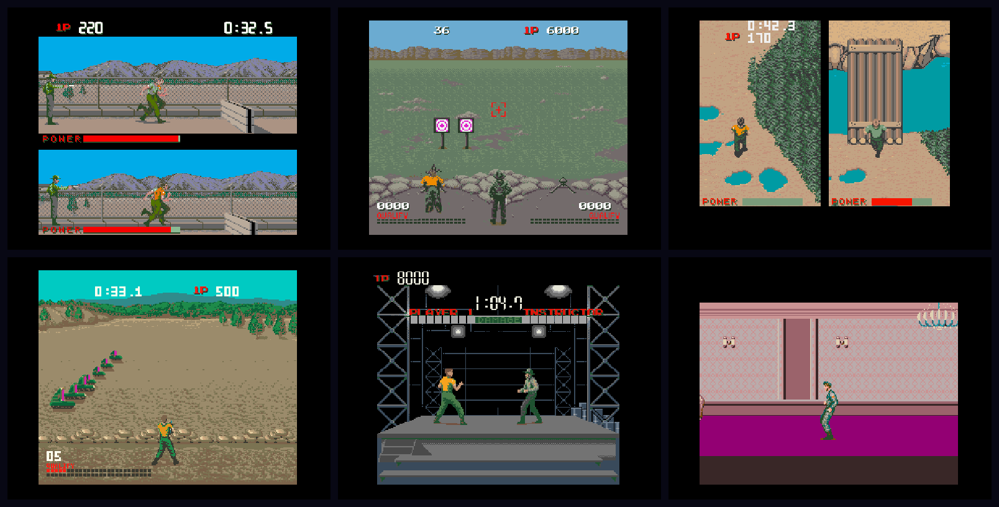

# Combat School for MSX + V9990

**Konami's 1987 arcade training course and rescue mission, adapted for MSX with Yamaha V9990 graphics.**

An unofficial homage port by **DiHalt Studio**, 2026.

## Play it

[Download version 1.0](https://github.com/DiHaltStudio/combat-school-v9990/releases/tag/v1.0). The cartridge is a **2 MiB ASCII16 MegaROM**. Use an MSX with a V9990 cartridge and a flash cartridge that supports ASCII16. The startup credits appear on the MSX video output. The game uses the V9990 video output and the MSX's built-in sound.

- [English user manual](V9990/docs/manual/manual-en.pdf)
- [Manual en español](V9990/docs/manual/manual-es.pdf)
- [Printable cartridge label](V9990/docs/manual/img/sticker.png)

To play in openMSX, extract the release archive and run:

    openmsx -machine Philips_NMS_8250 -ext gfx9000 -cart CombatSchool-V9990.rom -romtype ASCII16

From this repository, put the downloaded ROM in release/ and use make run.

| Action | Keyboard | Joystick 1 |
|---|---|---|
| Run, arm-wrestle, do pull-ups | Tap Space | Tap button 1 |
| Steer, move, aim | Cursor keys | Directions |
| Shoot or kick | Space | Button 1 |
| Jump | M | Button 2 |

Play as Nick, complete seven training events, and take on the instructor. After graduation, enter the occupied building and rescue the hostages. Joe is the computer-controlled rival.

## What is this?

This port implements the arcade's course, shooting, arm-wrestling, instructor fight, graduation and final mission on the MSX. It uses V9990 bitmap graphics, music through the MSX PSG, and a single-player ranking. The arcade and Spectrum editions serve as references for the art, rules and sound.

## Building from source

    git clone https://github.com/DiHaltStudio/combat-school-v9990.git
    cd combat-school-v9990
    python3 -m venv V9990/build/venv
    V9990/build/venv/bin/pip install -r V9990/requirements-build.txt
    make

The build reads original arcade and Spectrum material from your local files. The repository and the release archive do not contain the original arcade ROM set, Spectrum tape or separate driver dump. See [Building from source](docs/BUILDING.md) for paths, tools and input format.

## Repository layout

| Path | Contents |
|---|---|
| [V9990/src/](V9990/src/) | Z80 programs for the V9990 port |
| [V9990/assets/](V9990/assets/) | Art and data used by the port |
| [V9990/tools/](V9990/tools/) | Capture scripts, converters and builders |
| [V9990/docs/](V9990/docs/) | Manual sources, artwork and PDFs |
| [musicPsg/](musicPsg/) | Arrangements and tools for the PSG |
| [docs/DESIGN.md](docs/DESIGN.md) | Cartridge and graphics design |

## Make it better

Source code available on GitHub. **Please improve the game if you feel so!** You can refine obstacle layouts, adjust the PSG arrangements, or improve the V9990 drawing and build tools.

## Credits and rights

Original arcade game by **Konami, 1987**. MSX adaptation by **DiHalt Studio, 2026**. Spectrum 128K music by **Jas. C. Brooke** for the Ocean edition, adapted for MSX PSG. MSX is a trademark of MSX Licensing Corporation. The game and related artwork, names and music belong to their respective rights holders.

This is an unofficial homage made for study and preservation. It is not affiliated with Konami or the other rights holders.
